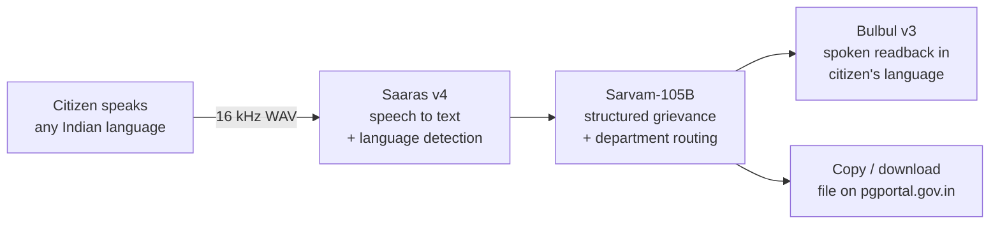

# Shikayat Saathi

**बोलिए, हम लिख देंगे।** Speak a complaint in any Indian language, get a ready-to-file grievance for [CPGRAMS](https://pgportal.gov.in), the Government of India's public grievance portal.

**Live demo:** https://between-headline-vertical-faq.trycloudflare.com
(works on phone, tap the mic or try a sample)

Built for the Sarvam AI hackathon, Oct 2026.

## The problem

CPGRAMS works, but only for people who can write a formal complaint in English and know which ministry handles their issue. A retired railway employee whose pension stopped, or a village with no electricity for a week, usually can't do either. So they give up, or pay an agent to write it.

## What it does

1. **Bolo (speak):** the citizen taps the mic and talks in their own language: Hindi, Tamil, Telugu, Bengali, code-mixed, anything Saaras supports. Or they upload a voice note.
2. **Jaancho (check):** the app drafts a formal English grievance with subject, category, the right department, location, date, relief sought and urgency. It then **reads a confirmation back in the citizen's language**, so they can check it by listening even if they can't read English.
3. **Bhejo (file):** copy or download the grievance and paste it into pgportal.gov.in.

## Why it's more than a wrapper

- **Correct routing, not a generic guess.** A railway pension goes to the Ministry of Railways, not the generic pension department. Water, power, police and land are routed as State subjects. A pension stuck at the bank goes to the Department of Financial Services.
- **No invented facts.** The model is told never to make up names, IDs or dates. It leaves a placeholder like `[PPO number]` in the draft and **asks the citizen for it in their own language** (for example, "पिताजी का PPO नंबर क्या है?").
- **Voice in, voice out.** Built for people who are more comfortable speaking than typing, not just a chat box.
- **Robust audio.** The browser converts any recording to 16 kHz mono WAV before upload, so Chrome, Safari and WhatsApp voice notes all work.

## Sarvam APIs used



| Step | API | Model |
|---|---|---|
| Voice to text, auto language detection | Speech to Text | `saaras:v4` |
| Drafting, routing, follow-up questions | Chat Completions (JSON mode) | `sarvam-105b` |
| Spoken confirmation | Text to Speech | `bulbul:v3` (fallback `bulbul:v4-flash`) |

Tested end to end in **Hindi, Tamil and Telugu** (speech in, draft, spoken readback).

## Project structure

```
app.py              FastAPI backend: /api/transcribe, /api/draft, /api/speak, serves the frontend
static/index.html   Whole frontend: vanilla JS, no build step, mobile-first
check.py            Calls each Sarvam API once (chat, TTS, then STT on the TTS audio)
NOTES.md            Verified Sarvam API facts: models, limits, formats
```

The API key lives only in `.env` on the server. It is never sent to the browser and never committed.

## Run it locally

```bash
python3 -m venv .venv && source .venv/bin/activate
pip install -r requirements.txt
cp .env.example .env        # paste your Sarvam API key into .env
python check.py             # should end with ALL CHECKS PASSED
uvicorn app:app --port 8000
```

Open http://localhost:8000.

## Deployment

It runs on a VPS: uvicorn on localhost in tmux, exposed over HTTPS with a Cloudflare tunnel (`cloudflared tunnel --url http://localhost:8010`). HTTPS matters because phone browsers only allow mic access on secure origins.

## Limits and next steps

- Sarvam's REST speech-to-text takes up to 30 s per request, so recordings are capped at 29 s. Record again to add details. Next step: the batch or streaming API for longer complaints.
- The app drafts the grievance but doesn't submit it. CPGRAMS has no public filing API, so the citizen pastes the draft into the portal. Next step: a guided walkthrough of the portal form.
- Next: grievance tracking reminders over WhatsApp, and photo upload of supporting documents via Sarvam Vision.

Always review a draft before filing.
